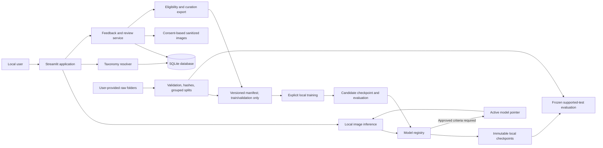

# Wildlife & Animal Intelligence System — Final Project Report

**Report date:** 2026-11-05
**Project specification:** `PROJECT_SPEC.md`
**Implementation roadmap:** `plan.md`
**Workspace:** Windows local project, CUDA-enabled PyTorch environment

**Detailed implementation reference:** [`IMPLEMENTATION_GUIDE.md`](IMPLEMENTATION_GUIDE.md)

**Final status:** Academic research prototype; implementation and local experiments are complete. There is no production-approved active model. Candidates can be run only through the explicit, visibly experimental local development/demo mode, which does not alter registry state and does not accept feedback. Production inference remains unavailable until rights, taxonomy, OOD, consent/review, and promotion gates are resolved.

## Project summary

The project implements a local eight-class animal-image classification workflow, a versioned taxonomy importer and name resolver, consent-aware feedback and review, curation safeguards, a Streamlit application, model evaluation, ResNet18 Grad-CAM, and an explicit model-candidate registry with policy-gated promotion and rollback.

The component inventory, CLI instructions, local candidate-demo procedure, implementation/test coverage and outstanding governance requirements are documented in [`IMPLEMENTATION_GUIDE.md`](IMPLEMENTATION_GUIDE.md).

The refreshed models were trained on the verified files currently present in `data/raw/`. The newly inspected Wolf folder contains 1,346 valid images. Those files were missing from the older manifest used for the first experiments. A new manifest and new model runs were created without replacing the old manifest or its evaluation reports.

The user has now provided a source mapping and dataset pages, and the linked source cards were reviewed on 2026-11-05. The mapping is documented below. However, the current raw folders still lack per-image source IDs/licence records, some linked source pages have unknown or restrictive rights, and the correspondence of individual local files to those pages has not been verified. This is not sufficient to claim rights-cleared public use. No reviewed taxonomy snapshot/external taxon mapping is installed, no separate OOD datasets are available, and numerical promotion criteria have not been approved.

## Architecture



Taxonomy membership, model-supported outputs, user feedback, verified curated examples, and immutable model versions are represented separately. Feedback does not trigger retraining. The local reviewer screen is not authenticated; a reviewer reference is self-declared attribution only.

## Environment and reproducibility

Verified development environment:

| Component | Version / device |
|---|---|
| Python | 3.14.8 |
| PyTorch | 2.14.1+cu130 |
| Torchvision | 0.29.1+cu130 |
| CUDA runtime | 13.0 |
| GPU | NVIDIA GeForce RTX 3050 6GB Laptop GPU |
| Detected VRAM | 6,441,926,656 bytes |

Use the project interpreter, not a global `streamlit` launcher:

```powershell
.\.venv\Scripts\python.exe -m pip install -r requirements.txt
.\.venv\Scripts\python.exe -m streamlit run app.py
```

For CPU-only setup use `requirements-cpu.txt` instead of `requirements.txt`. Do not install both variants into the same environment. GPU verification and complete experiment commands are documented in `README.md`.

## Dataset inspection

Current manifest: `data/manifests/dataset_manifest-20261105-current.csv`
Manifest SHA-256: `c8e633e6b0056aabc3436c3114a2c7737fe9b53c436cc5d568103bd1b60aa7a6`

| Canonical class | Valid images | Train | Validation | Test |
|---|---:|---:|---:|---:|
| Domestic Cat | 2,371 | 1,660 | 356 | 355 |
| Domestic Dog | 4,978 | 3,484 | 747 | 747 |
| Lion | 2,007 | 1,405 | 301 | 301 |
| Tiger | 2,156 | 1,509 | 324 | 323 |
| Leopard | 1,345 | 941 | 202 | 202 |
| Gray wolf | 1,346 | 942 | 202 | 202 |
| Cheetah | 1,375 | 963 | 206 | 206 |
| Jaguar | 900 | 630 | 135 | 135 |
| **Total** | **16,478** | **11,534** | **2,473** | **2,471** |

The scan found no corrupt supported-format images and no byte-identical duplicate groups. Four non-image files were excluded in the earlier full folder audit; the current refresh found no additional unknown class folders. No observation/group metadata was supplied, so grouping only covers exact hashes; perceptual near-duplicate detection is not implemented.

The previous manifest contains 15,190 images, including 58 Gray wolf images. All 58 old Wolf paths still exist and their hashes match. The current Wolf folder has 1,346 images, so 1,288 images were absent from the previous manifest. The old manifest and its frozen split were preserved; all results below use the new manifest and must not be mixed with the earlier experiment.

### User-reported source mapping and linked-source audit

| Class(es) | User-reported source | Linked page information observed | Remaining issue |
|---|---|---|---|
| Domestic Cat, Domestic Dog | Oxford-IIIT Pet Dataset; Academic Torrents link supplied | [Oxford-IIIT official page](https://www.robots.ox.ac.uk/~vgg/data/pets/) identifies 37 pet breeds, roughly 200 images per breed, and CC BY-SA 4.0 for the dataset; it says image copyright remains with original owners. The [Academic Torrents record](https://academictorrents.com/details/b18bbd9ba03d50b0f7f479acc9f4228a408cecc1) identifies the Oxford-IIIT Pet Dataset and repeats those terms. | Record page-level source/terms. Still need verify the local cat/dog files against the archive and preserve available image/breed provenance and attribution. |
| Jaguar | Kaggle `iluvchicken/cheetah-jaguar-and-tiger`, selected `jaguar_train_resized` | [Kaggle dataset card](https://www.kaggle.com/datasets/iluvchicken/cheetah-jaguar-and-tiger?select=jaguar_train_resized) is titled “Cheetah, Hyena, Jaguar and Tiger.” Its description says 900 training and 100 validation images per listed type and no provided test images. Kaggle metadata reports the licence as **Unknown**. | The page identifies the dataset but does not establish a reuse licence. User's local Jaguar files have no per-image identifiers showing they came from this subset. |
| Cheetah | images.cv | [Cheetah card](https://images.cv/dataset/cheetah-image-classification-dataset) lists 1,453 labeled images, “CC0: Public Domain,” and source “Animals detection images dataset” (a Kaggle dataset). | Card count differs from 1,375 local images. The card’s stated terms do not by themselves establish that each local file is from this source. |
| Leopard | images.cv | [Leopard card](https://images.cv/dataset/leopard-image-classification-dataset) lists 1,401 images and CC0; it attributes the source to “Animal image dataset” on Kaggle. | Card count differs from 1,345 local images; no per-image mapping. |
| Lion | images.cv | [Lion card](https://images.cv/dataset/lion-image-classification-dataset) lists 2,129 images and CC0; it attributes the source to “Animals detection images dataset” on Kaggle. | Card count differs from 2,007 local images; no per-image mapping. |
| Tiger | images.cv | [Tiger card](https://images.cv/dataset/tiger-image-classification-dataset) lists 2,280 images and CC0; it attributes the source to “Animal image dataset” on Kaggle. | Card count differs from 2,156 local images; no per-image mapping. |
| Gray wolf / wolf labels | images.cv | [Wolf card](https://images.cv/dataset/wolf-image-classification-dataset) lists 60 images and CC0, with source “Animal image dataset” on Kaggle. [Red wolf](https://images.cv/dataset/red-wolf-image-classification-dataset) lists 1,274 and [White wolf](https://images.cv/dataset/white-wolf-image-classification-dataset) lists 1,269; both say “Academic Research © Original Authors,” source ImageNet object localization, and “Submitter license: not stated.” | The three page counts sum to 2,603, while the local Gray wolf folder has 1,346 images. The pages do not establish that the datasets are disjoint or that their red/white labels all mean Gray wolf. The academic-research/original-author terms need review before reuse; source page labels are not enough to validate taxonomy. |

These are page-level facts and a source assignment reported by the user, not verified per-file provenance. The source cards’ totals are not assumed to be counts of the local folders, and sources are not treated as disjoint. The raw folder and manifest records still contain blank per-image source/licence fields; no provenance was retroactively fabricated. The observed counts and model scores do not establish licence clearance or scientific label correctness.

## Training and test evaluation

Both models used the same current manifest, seed 42, validation-based checkpoint selection, and the same 2,471-image test split. Test metrics were generated after training and were not used for parameter or threshold tuning.

| Model | Training configuration | Best validation accuracy | Test accuracy | Macro precision | Macro recall | Macro F1 | Forward-only throughput | Checkpoint size |
|---|---|---:|---:|---:|---:|---:|---:|---:|
| ScratchCNN | 10 epochs; batch 32; 463.9 s | 71.37% | 68.35% | 67.86% | 68.63% | 67.72% | 792.5 images/s | 1,584,801 bytes |
| ResNet18 | 5 frozen-head + 5 fine-tuning epochs; batch 16; 421.4 s | 95.92% | 94.94% | 93.51% | 93.44% | 93.44% | 695.9 images/s | 44,808,267 bytes |

Both training runs used the RTX 3050 with CUDA mixed precision. Peak allocated VRAM was 690,946,560 bytes for ScratchCNN and 400,811,520 bytes for ResNet18. Throughput measurements are synchronized model forward passes; data loading is excluded.

ResNet18 per-class test results:

| Class | Precision | Recall | F1 | Test support |
|---|---:|---:|---:|---:|
| Domestic Cat | 98.29% | 96.90% | 97.59% | 355 |
| Domestic Dog | 97.74% | 98.53% | 98.13% | 747 |
| Lion | 96.92% | 94.02% | 95.45% | 301 |
| Tiger | 97.82% | 97.21% | 97.52% | 323 |
| Leopard | 87.05% | 83.17% | 85.06% | 202 |
| Gray wolf | 91.09% | 91.09% | 91.09% | 202 |
| Cheetah | 83.63% | 91.75% | 87.50% | 206 |
| Jaguar | 95.52% | 94.81% | 95.17% | 135 |

Detailed JSON and confusion matrices are under `reports/metrics/refreshed-20261105/`; confusion and training-history SVGs are under `reports/metrics/figures/`. Model checkpoints and histories are under:

- `models/runs/scratch_cnn-20261104T222824Z/`
- `models/runs/resnet18-20261104T223628Z/`

### Demonstration observations

- A real Gray wolf image from the current test split produced a Gray wolf top prediction on CUDA with a 0.9999 softmax score.
- An inspected current test image `cat/Abyssinian_226.jpg`, labelled Domestic Cat in the manifest, produced Domestic Dog with a 0.6266 softmax score.

These are illustrative individual examples, not estimates of typical behavior. Softmax scores are uncalibrated model scores, not probabilities. Aggregate metrics and the confusion matrix are more informative.

## Application and model lifecycle

The audited worktree app was started using the project `.venv` at `http://127.0.0.1:8502`; its Streamlit health endpoint returned HTTP 200. Classify, Taxonomy, Review, and Models were navigated in the live browser without runtime exceptions. The frontend now uses a responsive wildlife-themed visual style, consistent page hierarchy and navigation, light-theme contrast for widget labels and controls, clear candidate/result layouts, and styled upload, alert, card, button, and table surfaces.

Classify separates production inference from explicit local development/demo mode. The demo lists only registered candidates, validates artifact path and SHA-256, and marks outputs experimental. It accepts candidate-linked feedback for later review but cannot change the production active-model pointer. The current local SQLite database contains three candidate models, no active model, and no promotion policies. Production promotion was not attempted because numerical acceptance/regression criteria must be approved before candidate evaluation; none were supplied.

The app's Taxonomy and Review pages accurately reflect the live database's empty taxonomy and feedback state. Isolated tests exercise candidate-linked direct-class feedback, review, and curation without requiring taxonomy data; a separate taxonomy test continues to cover name import/search/confirmation. Synthetic records and promotion state do not touch the live database.

## Verification

- Full test suite after the direct-class feedback changes: **38 passed**.
- Streamlit `AppTest` exercised candidate selection, image upload, inference, predicted label, uncalibrated score, alternatives, and experimental labeling. Feedback controls are absent in demo mode.
- Streamlit `AppTest` exercises an isolated taxonomy → candidate registration → ResNet18 classification/Grad-CAM → candidate-linked direct-class feedback → review → curation flow and verifies the exported manifest in the temporary project only. This does not activate or approve any live candidate.
- Python source compilation: passed.
- Streamlit live health endpoint: HTTP 200.
- Live browser navigation: Classify, Taxonomy, Review, and Models pages rendered without runtime exceptions.
- `git diff --check`: passed after the final audit and frontend changes.
- CUDA training and evaluation: completed for both current-manifest models.
- Real-image ResNet18 inference on a current Wolf test sample: completed on CUDA.
- Candidate listing test confirms demo-available candidates remain `candidate` and no production active-model row is created.

## Outstanding requirements and blockers

1. **Data provenance and rights:** The user supplied source mapping and links, now documented above. Still reconcile local files to the cited versions using filenames, archive manifests, source IDs, or checksums; preserve per-image attribution/licence where available; and resolve the Kaggle Jaguar licence and images.cv red/white wolf restrictions/underlying image rights. Until that is done, do not claim the dataset is cleared for public redistribution or deployment.
2. **Taxonomy snapshot:** Provide a reviewed versioned source CSV with release, licence, attribution, and taxon mappings. No production taxonomy records were fabricated; only synthetic unit-test data exists.
3. **OOD evaluation:** Provide separate versioned OOD development and final holdout datasets. No OOD recognition or false-acceptance claim is made, and no abstention threshold is selected.
4. **Promotion policy:** Supply criteria approved before a future candidate evaluation. Until then, both models remain candidates and production inference remains disabled. The local demo mode is available for explicitly experimental use and is not production promotion.
5. **Consent and review policy:** Confirm user-facing consent wording, retention period, review SOP, and handling of model descendants after withdrawal. The local application has no authenticated reviewer roles.
6. **Near duplicates and groups:** Provide observation/source group metadata or an approved near-duplicate method to detect related photos beyond exact byte-identical files.
7. **Final visual evidence:** The refreshed live app was visually inspected in the browser; persistent screenshot files were not added to the repository.

The codebase and available local experiments are implemented and tested. These external data and governance inputs remain necessary to satisfy the corresponding specification acceptance criteria; they cannot be truthfully completed from the files and decisions currently available.
